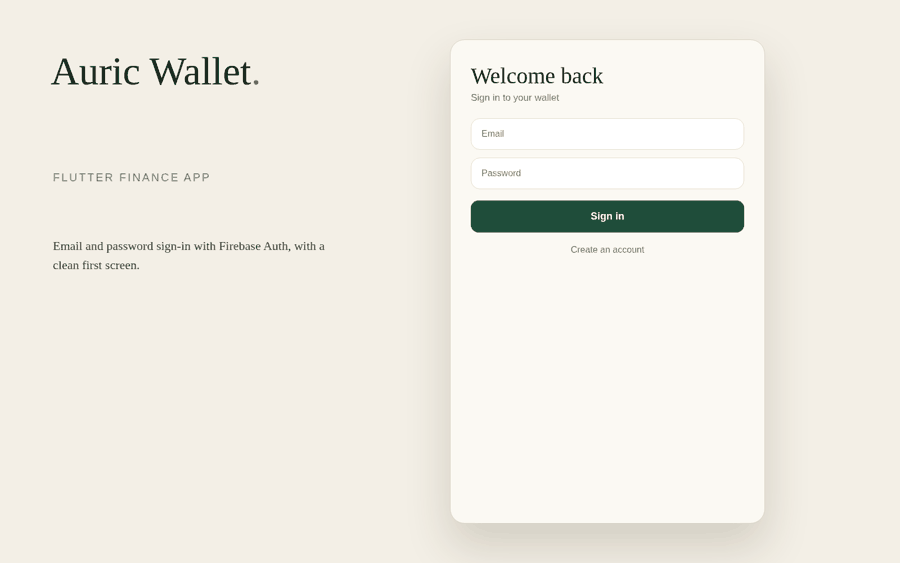
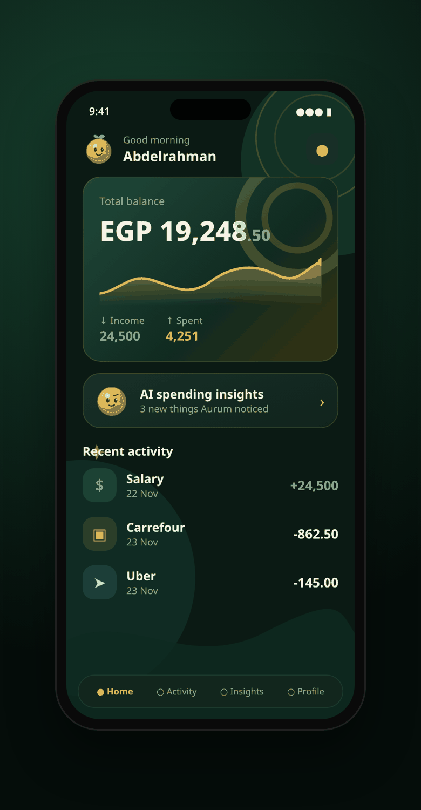
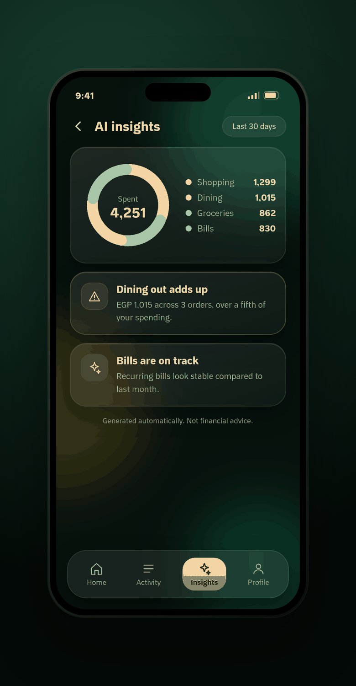
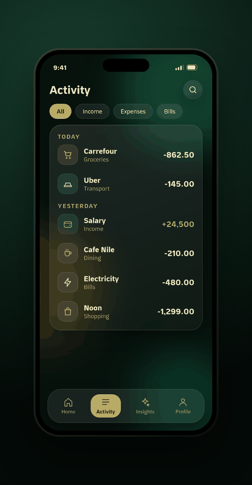
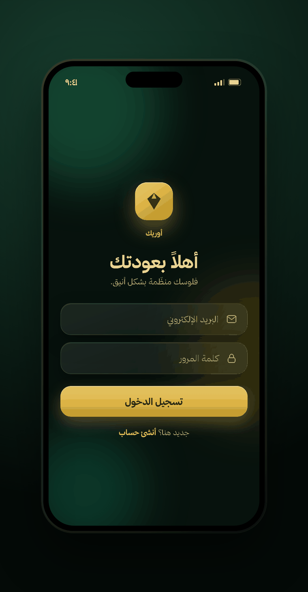
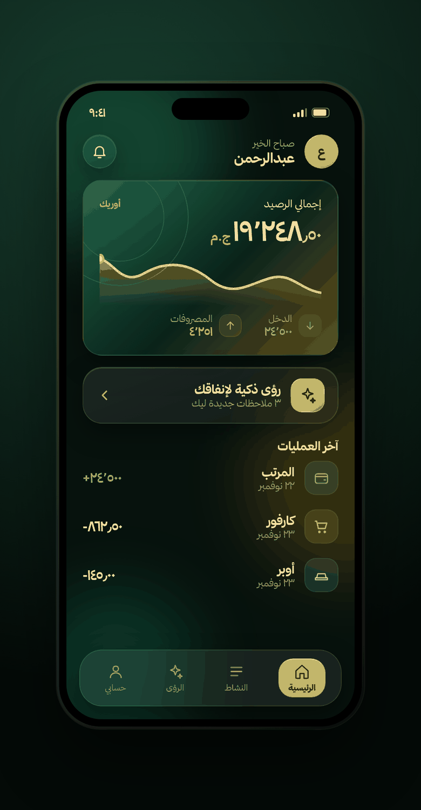
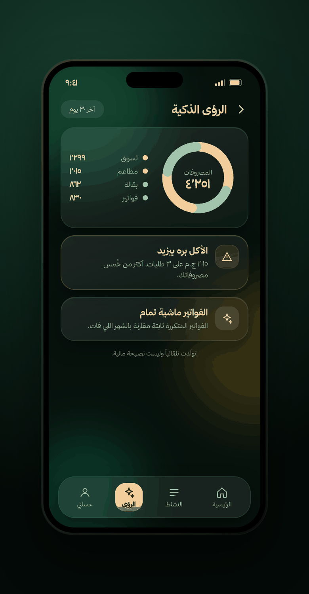
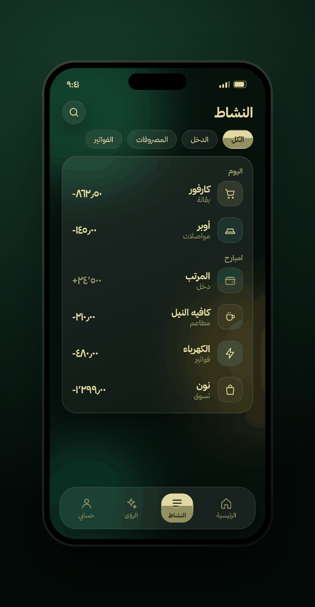

# Auric Wallet

A personal-finance wallet app built with Flutter. Dark green and gold design, Firebase-ready data layer, and an AI spending-insights feature.

> Personal demo project. Not a client project and not published on any store.
> Built with an AI-assisted workflow. The Dart code has unit tests but has **not yet been run on a device or emulator**, and the images in `docs/screens` are premium glass-style UI mockups of the designed screens, not recordings of the running app.

## Screens

| Login | Home | AI insights | Activity |
|---|---|---|---|
|  |  |  |  |

## Arabic (RTL) screens

The same four screens with Egyptian Arabic copy and a full right-to-left layout. Mockups only, not app recordings. Arabic text is set in Thmanyah Sans by Thmanyah (free font).

| 1 | 2 | 3 | 4 |
|---|---|---|---|
|  |  |  |  |

## What it shows

- **Design system to code.** All colours and component styles live in `lib/theme/app_theme.dart` as tokens, the way a Figma style guide is structured.
- **Firebase auth + Firestore.** Email/password sign-in and a live transaction stream at `users/{uid}/transactions`.
- **AI spending insights.** The app sends category totals (no merchant names) to a backend proxy that calls an LLM and returns structured JSON insights. If the call fails, times out, or no URL is set, a rule-based fallback is used, so the screen never breaks.

## Architecture

```
lib/
  main.dart               wiring: picks mock or real services from build flags
  theme/app_theme.dart    design tokens + ThemeData
  models/                 WalletTransaction, SpendingInsight
  services/
    auth_service.dart         AuthService  -> FirebaseAuthService | MockAuthService
    wallet_repository.dart    WalletRepository -> Firestore | Mock
    insights_service.dart     InsightsService  -> LlmInsightsService | MockInsightsService
  screens/                login, home, insights, auth gate
  widgets/                balance card, transaction tile
```

Screens depend on small interfaces (`AuthService`, `WalletRepository`, `InsightsService`). That is why the same UI runs on mock data, on Firebase, and with or without AI, with no screen changes. State is passed with `provider`.

## Run it

This repo contains the Dart source (`lib/`, `test/`, `pubspec.yaml`). Generate the platform folders first:

```bash
flutter create . --project-name auric_wallet --org dev.example
flutter pub get
flutter run                      # mock mode: no accounts or keys needed
flutter test
```

Real Firebase: create a Firebase project, run `flutterfire configure`, enable Email/Password auth and Firestore, then:

```bash
flutter run --dart-define=USE_FIREBASE=true
```

Real AI insights: deploy a small backend (for example a Cloud Function) that holds the model API key, accepts `{"summary": {...}, "format": "insights_v1"}` and returns `{"insights":[{"headline":"","detail":"","warning":false}]}`, then:

```bash
flutter run --dart-define=INSIGHTS_URL=https://your-backend/insights
```

The API key is never stored in the app.

## Known limits

- Untested on device (see note above). Expect small fixes on first run.
- Only reading and adding transactions is modelled. No budgets, transfers or real banking.
- Insights are informational, not financial advice.
